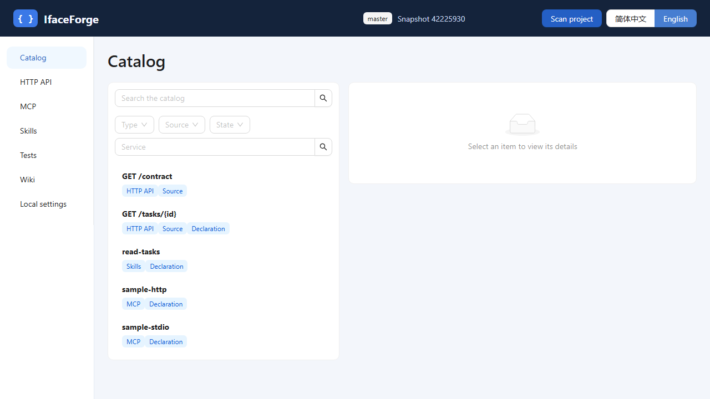

# 接口工坊 · IfaceForge

接口工坊是一个面向单个 Git 项目的本地工作台。扫描 OpenAPI、MCP 配置、有限的源码路由和 `SKILL.md`，调试 HTTP 和 MCP，保存用例并导出 Markdown Wiki。Web 界面支持简体中文和英文，CLI `ifg` 可直接读写同一项目的 SQLite。

IfaceForge is a local workbench for a single Git project. Discover HTTP APIs, MCP capabilities and skills, debug requests, run saved cases, and export a Markdown Wiki. The bilingual Web interface and the CLI share a project SQLite database.



## 快速启动 · Quick start

需要 Git 和 Node.js 26 LTS。兼容 Node.js 24 LTS，实际验收版本见发布报告。

Requires Git and Node.js 26 LTS. See the release report for verified versions, including Node.js 24 LTS.

```sh
git clone https://github.com/qq940500529/ifaceforge.git
cd ifaceforge
npm ci
npm run build
node dist/cli/main.js start --no-open --json
```

打开输出中的 `data.url`。使用 `--project <path>` 指向其他 Git 工作树。省略 `--no-open` 会打开浏览器。使用 `status` 查看状态，使用 `stop` 停止工作台。

Open `data.url` from the result. Add `--project <path>` for another Git worktree. Omit `--no-open` to open the browser. Use `status` and `stop` to manage the service.

解压发行包后，可直接运行 `node <path-to-package>/dist/cli/main.js start --project <path>`。发行包自带依赖。

The release archive includes dependencies. Extract it and start with `node <path-to-package>/dist/cli/main.js start --project <path>`.

## CLI

```sh
npm link
ifg commands --json
ifg scan --project . --include-untracked --json
ifg catalog search task --json
ifg wiki build --lang zh-CN --json
```

项目数据位于 `.devtools/ifaceforge/data/`。工作台只绑定回环地址。扫描不执行发现的项目代码。实际连接 MCP 时只启动用户明确选择的配置。

Project data lives in `.devtools/ifaceforge/data/`. The workbench binds to loopback. Scanning is read only. Connecting to an MCP server uses the profile you explicitly choose.

- [CLI usage](docs/cli.md)
- [Development specification](docs/development-spec.md)
- [Release and verification](docs/release.md)
- [Contributing](CONTRIBUTING.md)

MIT · Copyright (c) 2026 数链创元（天津）信息技术有限责任公司. [License](LICENSE)
