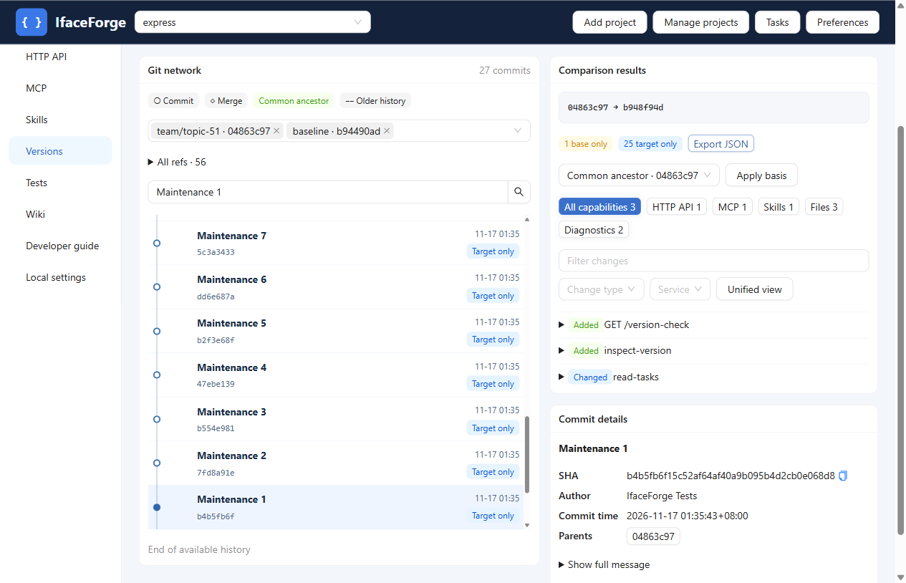

<div align="center">
  
  <h1>IfaceForge · 接口工坊</h1>
  <p><strong>面向 AI 应用项目的接口与技能工作台</strong></p>
  <p>在同一 Git 版本下查看 API、MCP 与 Skills，审查变更，并把接口验证保存为可复跑的用例。</p>
  <p>
    <a href="https://github.com/qq940500529/ifaceforge/releases/latest"></a>
    <a href="https://github.com/qq940500529/ifaceforge/actions/workflows/verify.yml"></a>
    <a href="LICENSE"></a>
  </p>
  <p><a href="https://github.com/qq940500529/ifaceforge/releases/latest">下载</a> · <a href="https://qq940500529.github.io/ifaceforge/">文档站</a> · <a href="docs/README.en.md">English</a></p>
</div>

## 快速开始

1. 从 [最新正式版](https://github.com/qq940500529/ifaceforge/releases/latest) 下载安装包，并确保 Git 在 `PATH` 中。
2. 打开 IfaceForge，点击 **添加项目**，选择本机 Git 工作树或其中的目录。远程仓库先克隆到本机。
3. 点击 **扫描项目**，在目录查看 API、MCP 与 Skills 的定义、来源和扫描诊断。

| 平台            | 桌面安装与验证                                                                         |
| --------------- | -------------------------------------------------------------------------------------- |
| **Windows x64** | 运行 EXE，可选择安装位置与快捷方式。向导和静默安装都提供同版本 `ifg`。已完成本机验收。 |
| **macOS ARM64** | 打开 DMG 后拖入有写入权限的目录。提供构建，未做本机实机验收。                          |
| **Linux x64**   | 运行 AppImage，或安装 DEB / RPM。提供构建，未做本机实机验收。                          |

> [!TIP]
> Windows 安装后，在新终端运行 `ifg --version --json` 核对版本。各平台也提供独立 CLI 包。[Windows 安装参数](docs/workbench.md#windows-交互与静默安装) · [CLI 安装](docs/cli.md)

## 工作台能做什么

- **扫描与审查**。读取 OpenAPI、Swagger、MCP 能力清单和 `SKILL.md`。可从支持的源码读取更多定义，跳转到文件与行号，并对比分支或提交。历史扫描按选定版本执行。[开发指南与兼容范围](docs/developer-guide.md)
- **验证 API 和 MCP**。发送 HTTP 请求、检查响应和断言。离线查看 MCP 声明，或临时启动服务发现并测试工具、资源、资源模板和提示词。保存用例、编排套件并查看运行记录。[MCP 测试指南](docs/mcp.md)
- **输出文档与报告**。生成本地 Wiki、保存手写说明，或导出 Markdown、目录 JSON 和对比报告。[桌面使用手册](docs/workbench.md)

客户端可管理多个本机 Git 项目。每个项目使用独立的本地 SQLite 数据，桌面与 `ifg` 共用项目登记、扫描结果与测试记录。[CLI 功能对照](docs/cli.md#desktop-actions-and-cli-equivalents)

<details>
<summary>查看 MCP 能力与测试界面</summary>


</details>

<details>
<summary>查看版本对比界面</summary>



</details>

## 文档与贡献

| 任务                                    | 入口                                                                                   |
| --------------------------------------- | -------------------------------------------------------------------------------------- |
| 安装、添加项目和使用桌面                | [用户手册](docs/workbench.md)                                                          |
| 脚本调用或 AI 接入                      | [CLI 参考](docs/cli.md) · [AI 调用指南](docs/cli-agent.md)                             |
| 编写可扫描、可验证的 API、MCP 与 Skills | [开发指南](docs/developer-guide.md)                                                    |
| 查看发行变化与参与开发                  | [更新日志](CHANGELOG.md) · [构建和发行](docs/release.md) · [贡献指南](CONTRIBUTING.md) |

<details>
<summary>从源码运行</summary>

使用 Git 和 Node.js LTS。

```sh
npm ci
npm run build
npm start
```

[开发与验证](CONTRIBUTING.md) · [构建和发行](docs/release.md)

</details>

[参与讨论](https://github.com/qq940500529/ifaceforge/discussions) · [提交问题或实机测试反馈](https://github.com/qq940500529/ifaceforge/issues/new/choose) · [安全报告](SECURITY.md)

[MIT](LICENSE) · Copyright (c) 2026 数链创元（天津）信息技术有限责任公司
