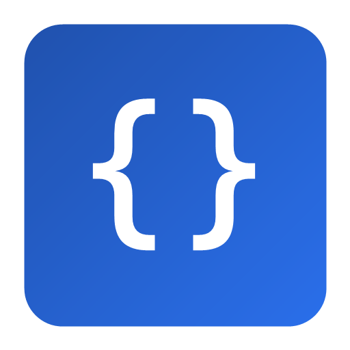

<div align="center">
  
  <h1>IfaceForge · 接口工坊</h1>
  <p><strong>面向 AI 应用项目的接口与技能工作台</strong></p>
  <p>在同一 Git 版本下查看 API、MCP 与 Skills，审查变更，并把接口验证保存为可复跑的用例。</p>
  <p>
    <a href="https://github.com/qq940500529/ifaceforge/releases"></a>
    <a href="https://github.com/qq940500529/ifaceforge/actions/workflows/verify.yml"></a>
    <a href="LICENSE"></a>
  </p>
  <p><a href="https://qq940500529.github.io/ifaceforge/">文档站</a> · <a href="docs/README.en.md">English</a> · <a href="docs/mcp.md">MCP 指南</a> · <a href="docs/cli.md">CLI</a> · <a href="CHANGELOG.md">更新日志</a></p>
</div>

## 适用项目

当一项业务能力既供应用调用，也供 AI Agent 使用，团队往往需要一起维护三类入口。**API** 提供程序调用的接口，**MCP** 让 Agent 发现和调用工具或读取资源，**Skills** 告诉 Agent 何时使用能力、按什么步骤完成任务。接口、工具参数或操作流程变更时，可以在同一 Git 版本下审查这些入口，并复跑接口测试。

| 项目类型                         | 为什么需要管理这些能力                                                                                                                                 |
| -------------------------------- | ------------------------------------------------------------------------------------------------------------------------------------------------------ |
| **AI 应用与 Agent 产品**         | 如企业助手、研发 Copilot、自动化运维助手。产品调用业务 API，Agent 通过 MCP 使用工具，Skills 记录处理流程。发布前需要一起核对接口、工具参数和操作步骤。 |
| **接入 AI 的业务系统与开放平台** | 如工单、数据或工程软件平台。同一项业务能力可能同时服务现有客户端、第三方应用和多个 Agent，团队需要核对各入口在不同版本中的变化。                       |
| **Agent 平台与工具生态**         | 如团队共享工具库、插件平台或工作流平台。多个团队维护服务及技能，平台需要按 Git 版本盘点可用能力、验证工具调用并整理交接文档。                          |

支持本机 Git 工作树。远程仓库先克隆到本机，单服务和多服务仓库都可添加，也可按需管理其中一类能力。OpenAPI、Swagger、MCP 能力清单和 `SKILL.md` 可跨语言扫描，源码识别随框架和注册方式而异。[开发指南与兼容范围](docs/developer-guide.md)

<a href="docs/mcp.md"></a>

## 开始使用

| Windows x64                       | macOS Apple Silicon              | Linux x64                          |
| :-------------------------------- | :------------------------------- | :--------------------------------- |
| 运行 EXE 安装向导，可选择安装位置 | 打开 DMG，把应用拖到有权限的目录 | 运行 AppImage，或使用 DEB / RPM 包 |

1. 从 [GitHub Releases](https://github.com/qq940500529/ifaceforge/releases) 下载对应安装包，并确保 Git 可从 `PATH` 找到。
2. 打开 IfaceForge，点击 **添加项目**，选择本机 Git 工作树或其中的文件夹。
3. 点击 **扫描项目** 查看目录。进入 **MCP**，选中仓库服务可发起隔离发现。使用已有能力声明时可直接离线查看。

Windows 安装向导默认创建开始菜单快捷方式，桌面快捷方式可选。自动化可用同一个 EXE 静默安装。[Windows 安装参数](docs/workbench.md#windows-交互与静默安装)

**平台验证范围**。Windows x64 已完成本机验收。macOS ARM64 和 Linux x64 提供构建，本次未做实机验收。欢迎试用并在 [GitHub Issues](https://github.com/qq940500529/ifaceforge/issues/new/choose) 提交系统版本、架构、安装包格式和复现步骤。

> [!TIP]
> 选中 MCP 条目即可打开测试。在同一处查看定义、填写参数、检查返回内容并保存用例。

### 浏览和比较 Git 版本

在顶栏选择要浏览的分支，或打开 **版本与对比** 从 Git 网络图选择两个提交。可查看接口定义变化、文件差异和来源，并导出 JSON 报告。历史内容按选择读取，适合拥有大量分支和提交的仓库。

<details>
<summary>查看版本对比界面</summary>


</details>

> [!TIP]
> 提交 OpenAPI、`mcp-capabilities.json` 和 `SKILL.md` 后，任何开发语言的项目都可以使用声明参与历史扫描。如何组织声明与测试，请参阅 [开发指南](docs/developer-guide.md)。

## 工作台

| 浏览                             | 测试                                         | 复用                             |
| :------------------------------- | :------------------------------------------- | :------------------------------- |
| MCP 工具、资源、资源模板和提示词 | HTTP 请求和 MCP 动作，含断言、耗时和错误明细 | 用例、顺序套件与 JSON 报告       |
| OpenAPI、部分源码定义和仓库技能  | 连续执行、取消、运行历史                     | 本地 Wiki、Markdown 和 JSON 导出 |

独立安装的桌面应用可同时管理多个本机项目。每个项目的数据存放在自己的 SQLite 数据库中。命令行工具 `ifg` 共用项目记录和用例。

<details>
<summary>从源码运行</summary>

使用 Git 和 Node.js LTS。

```sh
npm ci
npm run build
npm start
```

[开发与验证](CONTRIBUTING.md) · [构建和发行](docs/release.md)

</details>

## 文档与社区

[桌面使用手册](docs/workbench.md) · [MCP 测试指南](docs/mcp.md) · [开发指南](docs/developer-guide.md) · [CLI 参考](docs/cli.md) · [AI 调用指南](docs/cli-agent.md) · [发行记录](https://github.com/qq940500529/ifaceforge/releases)

[Discussions](https://github.com/qq940500529/ifaceforge/discussions) · [提交问题](https://github.com/qq940500529/ifaceforge/issues/new/choose) · [贡献指南](CONTRIBUTING.md) · [安全报告](SECURITY.md)

[MIT](LICENSE) · Copyright (c) 2026 数链创元（天津）信息技术有限责任公司
