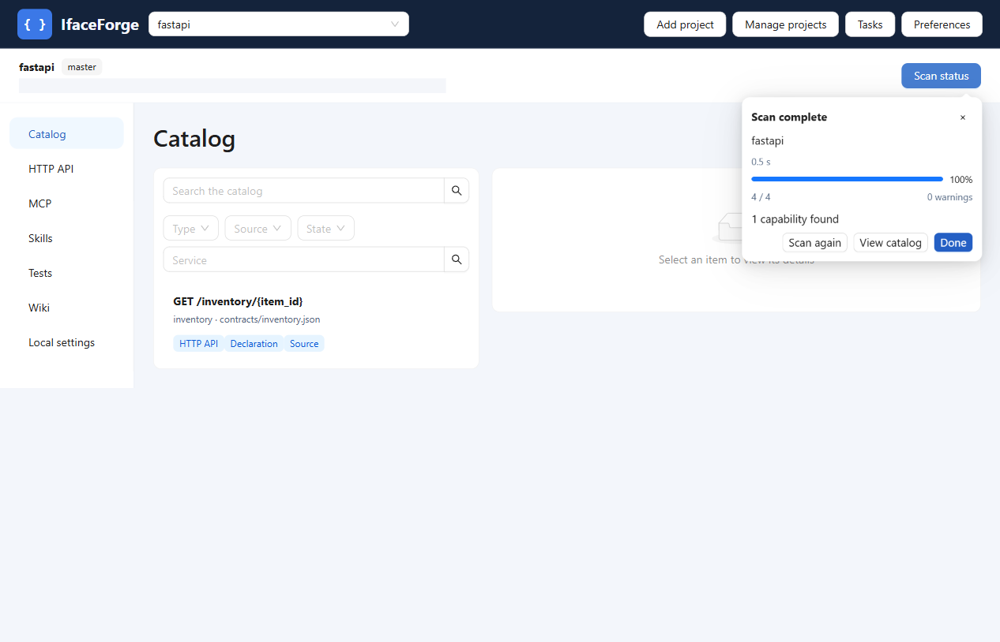

# IfaceForge

**Browse, debug and test interfaces across local Git projects in one desktop window.**

[Downloads](https://github.com/qq940500529/ifaceforge/releases) · [简体中文](../README.md) · [CLI reference](cli.md) · [Contributing](../CONTRIBUTING.md)

1. Pick the desktop package for your operating system and architecture from Releases. The Windows installer allows a custom location. On macOS, drag the app from the DMG. On Linux, use AppImage, DEB or RPM.
2. Open IfaceForge and select **Add project**. Pick a folder in a local Git worktree. If you select a subfolder, confirm the Git root. Git needs to be available on `PATH`.
3. Select **Scan project**. The in-app panel shows progress and lets you cancel or switch to another project. Open **Catalog** to browse the discovered interfaces.

Import OpenAPI and debug HTTP requests with assertions. Connect to MCP over stdio or Streamable HTTP and inspect tools, resources and prompts. Search repository skills, save reusable test suites and generate an offline Markdown and JSON Wiki.

Each project has an independent SQLite database in the app data directory. The desktop app includes its runtime. Use the optional [`ifg` CLI](cli.md) to work with the same project data from a terminal.

[User guide](workbench.md) · [Build and release](release.md) · [Development specification](development-spec.md)

[MIT](../LICENSE) · Copyright (c) 2026 数链创元（天津）信息技术有限责任公司
