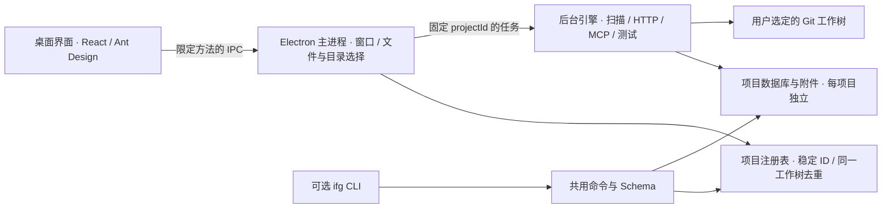

# IfaceForge 桌面版实施方案

审阅稿 · 2026 年 11 月 16 日（香港时间）

IfaceForge 将成为可独立安装的本地桌面应用。用户从系统文件夹选择器添加工作目录，在一个窗口切换多个 Git 项目。扫描、HTTP、MCP、技能、测试和 Wiki 沿用现有能力，由应用集中管理数据。桌面版按预览发布设计。现有 v0.1.0 为技术预览，作为功能回归参考。桌面安装器和原生系统对话框均待实施验证。

## 1. 范围与基本流程

1. **安装**。桌面包自带运行时。Windows 安装向导允许指定可写的本机目录。macOS 将应用拖到有权限的目录。Linux 用 AppImage 实现自选存放位置，用系统包管理器完成标准安装。
2. **添加项目**。首页提供「添加项目」，打开系统文件夹选择器。选择仓库根直接预览，选择子目录则显示实际 Git 工作树根并由用户确认，支持取消。重复选择同一工作树时切换到已有项目。首版继续使用 Git 工作树作为项目边界，普通文件夹显示原因与下一步。新增普通文件夹扫描将改变目录发现规则，单列需求评估。
3. **工作区**。项目列表显示名称、路径摘要、可用状态和最近扫描。选中项目后才呈现目录、HTTP、MCP、技能、测试、Wiki 和项目设置。切换项目保留各自的选择和未提交草稿。在「正在运行」中同时查看多个项目的任务，每条任务显示所属项目。
4. **移除与移动**。「从列表移除」保留本地记录并提示如何找回。「删除应用数据」为独立操作，明确项目、数据位置和影响范围，不删除源代码。目录失效时提供重新定位。更换到不同仓库时提示作为新项目添加，避免把旧配置和用例套到别的项目。
5. **本机与项目边界**。扫描在真实路径核验后的工作树内运行，跳过逃逸的符号链接和 Windows junction。发现配置只展示。实际连接 MCP 需用户选择目标并执行连接，限制到已批准的精确启动配置。工作区列表、运行和报告都留在本机。Git 仍是 Git 项目的外部依赖，安装包应能启动并在缺 Git 时提示探测或配置 Git 路径。

## 2. 技术选型与架构

优先选 **Electron、现有 React 与 Ant Design、electron-builder**。Electron 可复用现有 TypeScript 代码及浏览器渲染方式，打包工具支持 Windows 安装向导和 Linux 多种发行格式。Tauri 可作为原型未达安装体积或资源目标时的备选。它使用系统 WebView，三平台渲染引擎不同，现有 Node 扫描和 MCP 执行还需要维护独立进程。原型阶段实测冷启动、空闲内存和包体积，再锁定目标。Electron 官方维护最新三个稳定系列，桌面版使用受支持的稳定版本和最新补丁，开发和可选 CLI 继续选兼容的 Node LTS。 [Electron 支持策略](https://www.electronjs.org/docs/latest/tutorial/electron-timelines) · [Tauri WebView](https://v2.tauri.app/reference/webview-versions/) · [electron-builder NSIS](https://www.electron.build/v26/docs/nsis/)

- **主进程**管理单实例、原生菜单、窗口、文件夹选择及可审计的打开文件操作。渲染端使用 `preload` 暴露有限的异步方法。开启沙箱和 `contextIsolation`，关闭 `nodeIntegration`，检查 IPC 发送者和参数。网页来源、Markdown、接口响应和 MCP 输出按不可信内容展示。
- **引擎进程**优先用 `utilityProcess`。原型在打包后的 Windows、macOS、Linux 中检查 `node:sqlite` 的建库、读写、备份和恢复，以及 stdio MCP 的子进程回收。如果内嵌运行时无法提供所需 SQLite 能力，采用随包分发、按平台验证的独立 Node LTS 引擎，复用现有 SQLite 后端和消息契约。包内产物明确 Node、SQLite 和 Chromium 版本。
- **项目作用域**下沉到命令边界。项目操作接收稳定 `projectId`，且由可信进程解析真实根目录。UI 切换后迟到的结果按 `projectId` 和任务标识归档。相同远端的两个克隆属于不同项目，同一仓库的不同 Git worktree 也各自隔离。扫描、导出及配置读取以项目 ID 加参数固定目标，进行中的操作不随 UI 当前选项变化。
- **数据目录**与安装位置分离。构建时统一定义应用数据根，默认在 Windows 用户本地应用数据、macOS Application Support 和 Linux XDG 数据目录。注册表维护项目 ID 和位置，项目库及 Wiki 笔记置于 `projects/<projectId>/`。打开源码检查项目根，打开数据库和受管附件检查应用数据根，用户手动选定的导出路径单独校验。
- **CLI**保留扫描、请求、运行、导出及 JSON 契约，仍能在无窗口时工作。提供可选独立入口，可使用连贯的 Node LTS 安装说明。CLI 与桌面端共用注册表、记录格式、事务和版本冲突规则。桌面版文档给出新的应用启动方式、CLI 命令和退出状态。
- **凭据与信任**沿用环境变量引用和日志脱敏。若提供本地保存，引用存入项目库，密钥由受支持的系统加密提供方存管。Linux 的系统密钥服务不可用时提示改用环境变量或临时输入。项目工作区、开放文件选择器和 HTTP 请求分别授权，禁止渲染端直接提交任意 shell 字符串或无限制调用文件系统。 [Electron 安全指南](https://www.electronjs.org/docs/latest/tutorial/security/) · [原生对话框](https://www.electronjs.org/docs/latest/api/dialog) · [UtilityProcess](https://www.electronjs.org/docs/latest/api/utility-process) · [SafeStorage](https://www.electronjs.org/docs/latest/api/safe-storage)

### 扫描过程和 Windows 无终端窗口

当前项目页点击「扫描」后立即显示小浮窗，标题固定为「正在扫描 · 项目名」。浮窗给出阶段、经过时间、已处理项和已有警告。枚举阶段显示正在工作，取得可靠总量后显示进度条和 `已处理 / 总数`。完成时给出发现量、变更量及「查看结果」，失败给出简明原因和重试入口。收起浮窗不影响任务，可从页内扫描状态重新打开。显式点击「取消」停止待处理任务，保留上次完整快照。切换项目时浮窗显示其原所属项目，在当前页的任务入口仍可访问。

后台进程使用异步 Git 任务，参数数组直接传递，关闭 shell，Windows 进程统一启用 `windowsHide` 并使用管道收集输出。扫描阶段进度由实际枚举和解析事件驱动。按项目串行扫描，同一项目的重复点击重新打开当前浮窗。用安装包在 Windows 实测正常扫描、取消、扫描失败、长路径和退出回收，记录屏幕上没有命令行窗口。当前项目代码中的 Git 读取仍以同步调用为主，用户报告的控制台弹出作为桌面版专项验收项。

### 首次建库与备份恢复

首次添加项目时，按桌面版的初始结构在应用数据目录创建独立 SQLite，再从选定工作树扫描。桌面版无需读取、转换或兼容技术预览版的数据、备份或库结构。新建的项目数据按桌面版格式备份和恢复，恢复前核验受管文件清单、校验值、路径和项目归属，避免覆盖其他项目。验收覆盖从空数据目录启动、两个项目独立建库，以及桌面版自己的备份恢复。

### 代码、文档和测试处置

| 现有位置                                                                               | 桌面版处理                                                                                                               |
| -------------------------------------------------------------------------------------- | ------------------------------------------------------------------------------------------------------------------------ |
| `src/scanner`、`src/protocols`、`src/schemas`、`fixtures`                              | 保留并回归。扩展后台扫描进度、取消和项目切换隔离。                                                                       |
| `src/app/project.ts`、`src/storage`、`src/app/maintenance.ts`                          | 拆分项目定位、项目注册和数据路径。建立桌面版初始库结构，移除预览版库和备份格式的兼容分支。                               |
| `src/app/workbench.ts`、`src/web/client.ts`                                            | 分离共用命令、桌面 IPC 和 CLI。删除工作引擎对 Web 实例状态和端口的依赖。                                                 |
| `src/server/web.ts`、`src/server/instance.ts`                                          | 桌面入口切换后移除生产用回环服务、端口参数和实例锁。开发与 UI 测试可使用专用适配器。若确需提供浏览器模式，另起决策评审。 |
| `src/web`、`src/cli`                                                                   | 保留并更新。UI 改用项目列表、全局设置和项目设置。CLI 明确选项目，继续验证结构化输出及项目定位歧义。                      |
| `scripts/package.mjs`、`scripts/check-package.mjs`、`tests/e2e`                        | 以各平台安装器和端到端测试替换旧 Web 包检查。保留中文和空格路径、Windows 短路径、独立数据和退出回收的回归覆盖。          |
| `README.md`、`docs/cli.md`、`docs/development-spec.md`、`docs/release.md`、`AGENTS.md` | 新版交付时更新入口、技术约束和验收命令。技术预览的规格和验收记录可通过 v0.1.0 标签查阅。新产品文档按桌面操作路径组织。   |

## 3. 安装与发布矩阵

以下是首个桌面稳定版的拟支持范围。每一项按真实安装、运行、升级和卸载结果上架。未验证的系统或架构在下载页明确标注。

| 平台    | 首发格式和安装位置                                            | 候选系统与验收                                                                                                                                                             |
| ------- | ------------------------------------------------------------- | -------------------------------------------------------------------------------------------------------------------------------------------------------------------------- |
| Windows | x64 的 NSIS 向导，默认当前用户安装，允许选择有权限的本机目录  | Windows 11 x64。验证开始菜单、升级、卸载保留数据、中文安装路径和静默扫描。Arm64 取得实际设备或可靠测试环境后加到矩阵。                                                     |
| macOS   | Apple Silicon 的 DMG，用户拖放到可写目录                      | 目标覆盖当前和仍适合所选 Electron 版本的前一主要版本，在干净环境检查安装及首次启动。Intel 根据框架支持和真机验收决定是否同批上架。                                         |
| Linux   | x64 AppImage 可自由存放，提供 `.deb` 与 `.rpm` 供系统管理安装 | Ubuntu 两个在维护期的 LTS、Debian 当前稳定版、Fedora 当前受支持稳定版。核对 Wayland/X11、原生文件夹选择、AppImage 所需系统条件及包管理安装。首版分别写明已通过的桌面环境。 |

[electron-builder 打包与更新](https://www.electron.build/auto-update.html)

先交付完整安装包与应用内「检查更新」，将「下载并替换」和原地自动升级分别验收。Windows 和 macOS 的自动更新以受支持安装目录的原地升级通过为前提，Linux 原生包走系统包管理，AppImage 采用同类产物替换流程。桌面版升级前保留应用数据备份，升级失败可还原升级前的桌面版数据。安装后首次可离线启动。更新下载才访问发布源。

## 4. GitHub 仓库与文档方案

当前 `main`、MIT、公开 Issues 和 v0.1.0 技术预览产物已存在。读取仓库设置时，秘密扫描和推送保护已开启，Rulesets 为空，Dependabot 安全更新及私密报告关闭，Discussions 关闭，主页地址和 Topics 为空。Wiki 和 Projects 开关已开启，社区健康 API 返回 57%。仓库管理权限可用。现有 [v0.1.0 验收记录](https://github.com/qq940500529/ifaceforge/actions/runs/43849267002) 是后续比较的基线。

| 项目         | 拟启用或改造                                                                                                                                                                                                                                                            | 可核对的交付                                                                                                                               |
| ------------ | ----------------------------------------------------------------------------------------------------------------------------------------------------------------------------------------------------------------------------------------------------------------------- | ------------------------------------------------------------------------------------------------------------------------------------------ |
| 首页与入口   | About 改成双语友好的简短桌面定位，添加 `desktop-app`、`openapi`、`mcp`、`developer-tools` 等 Topics，设置下载或文档主页。使用合成项目的新桌面截图及社交预览图。                                                                                                         | 首屏能找到下载、用途、三平台、语言和文档。仅放有实际对应工作流的状态徽章。                                                                 |
| 贡献与沟通   | Issues 接收缺陷和可执行需求，表单包含版本、系统与架构、步骤、预期、实际、附件脱敏提示。Discussions 用于问答、想法和公告。Projects 用一个桌面版看板，Milestones 管理首发和补丁。                                                                                         | 缺陷、功能建议、文档问题各有入口。社区健康页可找到贡献指南、行为准则、安全政策和 PR 模板。                                                 |
| 合并与管理   | 先用远端已核验的 `main` 建立后续开发分支。现机器工作树与公开提交历史曾独立，接续时验证工作树差异，避免错误的首次合并。优先 squash 合并并自动删除合并分支。Ruleset 要求 PR、固定名称的验收检查和解决讨论，阻止强推与删除。只有有第二位维护者能接续审批时才启用强制审批。 | 先用实际 PR 验证分支规则和检查名称，再启用限制；发布工作流的权限独立于普通 PR。                                                            |
| 安全和供应链 | 保留现有秘密扫描和推送保护。启用私密漏洞报告、Dependabot 安全更新和有节奏的版本更新。添加跨平台渲染、SQLite、MCP 和安装回归。评估 CodeQL、依赖审查和固定 Actions commit SHA。分离 PR 验证与发行环境。                                                                   | 发行权限仅授予发布流程。每次发行生成 SHA-256、依赖许可、SBOM 与构建证明，待附件确认后发布。适用且维护流程成熟时开启不可变 Releases。       |
| 文档发布     | README 做快捷入口，详细说明在仓库文档中版本化。待内容稳定后将同一份文档生成 GitHub Pages。新版默认引导至版本化文档，整理旧 GitHub Wiki 入口前先核对并整理已有内容。                                                                                                     | 中英文都有下载、首次添加项目、扫描进度、HTTP/MCP、测试和 Wiki、备份恢复、CLI、故障排查。贡献者可找到开发及测试命令，维护者可找到发布手册。 |

从 [VS Code README](https://github.com/microsoft/vscode) 借鉴下载、文档和贡献入口的层次，从 [Zed 贡献指南](https://github.com/zed-industries/zed/blob/main/CONTRIBUTING.md) 借鉴新增贡献者的导航，从 [Electron 仓库](https://github.com/electron/electron) 借鉴平台发布和用户支持入口。分支、供应链和发版设置按 [GitHub Rulesets](https://docs.github.com/en/repositories/configuring-branches-and-merges-in-your-repository/managing-rulesets/about-rulesets)、[构建证明](https://docs.github.com/en/actions/how-tos/secure-your-work/use-artifact-attestations/use-artifact-attestations) 和 [Releases](https://docs.github.com/en/repositories/releasing-projects-on-github/managing-releases-in-a-repository) 落地。

README 首屏顺序建议为产品名与一句话、下载及平台支持、安装后第一个操作、合成项目截图、指南与贡献链接。单个截图突出项目切换与请求结果。新增功能页各用一条用户路径、一张带说明截图和一小节常见错误，避免在 README 重复 CLI 参考。使用真实安装截图后再替换目前的 Web 目录截图。继续使用 MIT，项目版权声明统一为 **Copyright (c) 2026 数链创元（天津）信息技术有限责任公司**，保留依赖各自的许可和版权。

## 5. 现有界面逐区审阅与改版

使用 Windows 本机 Chromium、独立合成工作树及 HTTP/MCP 样例，分别查看主要模块和真实运行结果。留存 19 张基线画面，覆盖中英文、1440 与 960 像素宽度、详情、表单和响应。逐按钮交互、详情展开和宽度矩阵见[操作审计清单](desktop-ui-audit.md)。

| 界面             | 当前观察                                                                                                                                          | 拟呈现方式                                                                                                                                                                                                                                                                                      |
| ---------------- | ------------------------------------------------------------------------------------------------------------------------------------------------- | ----------------------------------------------------------------------------------------------------------------------------------------------------------------------------------------------------------------------------------------------------------------------------------------------- |
| 窗口、导航与扫描 | 标题栏同时承载分支、快照、扫描和语言，紧凑宽度下快照文字换行。七项导航有清晰的选中态。                                                            | 左侧保留模块入口，以项目选择器作为全局锚点。顶部只放当前项目、分支和扫描状态。语言和主题移至应用设置。项目名可截短但可查看全名。紧凑宽度用侧栏折叠和详情抽屉。                                                                                                                                  |
| 目录、搜索与详情 | 类型、来源、状态和服务混在一行，标签颜色相近。源码弹窗用纯文本显示文件，标题带行号但正文未定位。                                                  | 显示筛选计数与清除入口，区分定义来源和状态。同名条目显示服务和来源。详情提供摘要、来源、差异和可展开原文。源码只读视图有等宽文本、行号、选中行高亮、复制路径。                                                                                                                                  |
| HTTP API         | 同屏先显示多个 JSON 编辑框和断言，发送在表单底部，响应排在下面。960 像素宽度时保存用例已经挪到下一行，响应超出首屏。导入弹窗依赖填路径。          | 方法、目标和发送独立固定到请求栏。参数与请求头提供键值编辑器，正文和断言按页签，原始 JSON 可切换。响应优先显示状态、耗时、正文与错误，并提供完整详情、下载和复制 cURL。预览随草稿变更而失效，响应标注实际请求及项目。导入文件使用选择器并显示预览。详见审计中的发送、预览、复制和保存连点结果。 |
| MCP              | 连接配置以 JSON 整块展示，发现的能力同时出现在通用目录和分类列表，工具 Schema、表单和 JSON 重复占用空间。切换分类后原先选中的工具详情仍留在下方。 | 服务列表内显示协议、连接状态和错误。详情用工具、资源、模板、提示词统一切换，清楚标出当前条目。基础字段和原始 JSON 使用切换视图。调用、读取、取提示词及取消在固定操作栏，Schema 和诊断按需展开。                                                                                                 |
| 技能             | Markdown、原文、引用和来源已有清晰分区。可用、缺失的引用标签颜色相近，正文里的链接缺少直接操作。                                                  | 阅读边栏、代码目录和引用列表。项目内引用提供预览或跳转，清楚标注缺失、外部和越界。原文可复制，保留只读使用方式。                                                                                                                                                                                |
| 用例、套件、历史 | 套件的 JSON 编辑器压过顺序编辑，主操作和删除并排。历史按技术 ID 或类型展示。                                                                      | 用例表单优先显示请求、环境、断言。套件用可排序行和键盘上移、下移，显示每步用例名。运行报告用时间线、步骤摘要和断言详情。删除有确认及影响说明。                                                                                                                                                  |
| Wiki             | 预览正文会展示很长的 OpenAPI 原文，把人工说明推到页面底部。选择路径依赖文本输入。                                                                 | 「内容树、预览、变更」分栏。JSON 默认折叠，手写说明可独立编辑，导出前先展示变更与冲突，使用原生保存位置选择。长文件保留小型操作栏、页内目录和回顶。                                                                                                                                             |
| 设置与数据       | 扫描、环境、备份路径和清理挤在同一页，大部分配置是 JSON。                                                                                         | 拆成应用和项目设置。环境表单按类型显示所需字段，JSON 为高级模式。备份、恢复、清理使用单独的操作流程，展示项目名、文件名、预估影响及结果。危险操作把确认和取消放在稳定位置。                                                                                                                     |

所有界面的完成标准包括图标名可读、键盘顺序合理、展开不丢焦点、长中文英文及路径可识别、状态有文字、滚动区域不遮盖操作栏。稳定版上架前测试 1440、1200、960、820、720、640、600 像素的有效内容宽度和系统高 DPI。按钮组在窄窗口按优先级换行，常用主按钮始终可达，低频动作进「更多」，危险操作保持明确标签。连续操作的提示按项目与任务合并，避免遮挡导航和状态。针对单个按钮、多按钮组合和连续操作分别验收。

## 6. 实施顺序与发布门槛

| 步骤            | 交付与完成条件                                                                                                                                       |
| --------------- | ---------------------------------------------------------------------------------------------------------------------------------------------------- |
| 1. 原型         | 以远端主分支建立开发分支。三系统打包后能启动空桌面，无额外 Node 安装，实测 SQLite 和 stdio MCP，确认原生选择目录和最低系统范围。                     |
| 2. 工作区与数据 | 添加、去重、移除、重新定位、同时处理两个项目的请求、跨项目取消隔离。验证首次建库、项目间数据隔离及桌面版备份恢复。                                   |
| 3. 全页面接通   | 完成扫描浮窗、页面级表单和命令适配，保留现有能力。用独立样例在每个平台完成项目选择、扫描、HTTP、两种 MCP 传输、技能、用例、套件、Wiki 和备份全流程。 |
| 4. 视觉与文档   | 双语实机截图、所有按钮和详情的交互、窄窗及高 DPI 截图回归。README、用户手册、贡献说明和 GitHub 设置能从公共入口核对。                                |
| 5. 发版         | 各支持项有干净机器的安装、升级和卸载证据，Windows 无扫描终端闪窗。核对摘要、验证来源和许可后发布预览包。额外架构按实际环境的验收结果上架。           |

核心验收是在两个不同 Git 工作树创建同名用例，在项目 A 扫描同时切换到 B 并保持两边状态正确。重复添加、越界路径、无 Git、目录移动、扫描取消和失败、启动中退出、升级前后的回滚各有明确结果。构建验收须使用安装包。Windows 的无终端窗口及页内小浮窗单独录屏确认。GitHub 以 PR 中的验证和对应发布资产的实测结果与摘要为准。

建议按优先级先完成可安装、多项目、独立建库、静默扫描和功能可用，再统一发布视觉和社区资料。排期在三平台原型后评估，避免把尚待验证的系统兼容性和安装包工作算成已完成。
