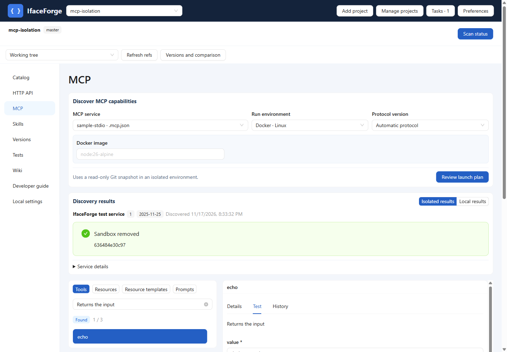

# MCP 工作台

[使用手册](workbench.md) · [CLI 示例](cli.md#mcp) · [下载](https://github.com/qq940500529/ifaceforge/releases)

MCP 工作台可离线查看仓库声明和源码注册，也可临时启动仓库服务，记录实际公布的能力。条目支持参数表单、原始 Schema、响应检查和保存为用例。

## 从源码读取能力

扫描项目后展开 **项目扫描记录**。源码结果链接到注册位置，包含可提取的名称、URI 和参数。完整的运行时 Schema 从临时发现取得，或随 `mcp-capabilities.json` 一起提交。Python FastMCP 支持装饰器、常量 URI 和可识别的类型注解，其他语言见 [兼容矩阵](compatibility.json)。

单仓库有多个服务时，可在 `.ifaceforge.json` 的 `sources` 中按目录配置服务范围。自定义注册可在来源的 `mcpRules` 声明扩展名、方法和能力类型，例如 `{"extension":"go","method":"ExposeTool","capability":"tool"}`。

## 在隔离环境中发现能力

1. 启动本机 Docker 的 Linux 容器引擎并准备所需镜像。纯 JavaScript 服务可用默认镜像 `docker pull node:26-alpine`。需要其他运行时或依赖时，使用含所需依赖及 `tar` 的镜像。
2. 把 MCP 启动配置和源码提交到 Git。例如在 `.mcp.json` 的 `mcpServers` 下声明 `{"command":"node","args":["server.mjs"]}`。也可在 **本地设置** 保存包含容器命令、参数和镜像的隔离配置。
3. 扫描项目后打开 **MCP**，选中仓库服务并选择 **Docker · Linux**。点击 **查看启动计划**，确认提交、镜像、命令、容器内工作目录和环境变量名，再点击 **启动并发现**。预检会阻止 Windows 启动器、缺失的工作目录或启动文件。仓库根目录找不到启动文件时，可使用同一提交中的配置文件所在目录。CLI 在 `mcp plan` 的 `issues` 字段返回问题。
4. 工作台读取工具、资源、资源模板和提示词的分页清单，显示协议版本与发现时间，并回收容器。再次选中同一提交中的服务，即可离线查看上次发现结果。CLI 可用 `ifg mcp inventory --service SERVICE_ID --json` 读取同一记录。

容器只接收 Git 提交的受限副本，工作目录只读，临时文件存放在 `/tmp`。容器使用非特权用户、隔离网络和资源上限。显式引用的环境变量才可注入。仅含远端地址的声明支持静态查看。Streamable HTTP 或旧版 SSE 需在容器内监听回环地址，镜像需有 Node 供 HTTP 转发使用。

发现和测试各有自己的临时容器。取消、超时、请求失败和部分发现也会回收实例。分类状态会标明空列表、权限不足或请求失败。容器回收状态在运行记录中单独显示。启动失败时，展开错误详情可查看和复制退出码、脱敏后的启动输出与清理结果。

## 在本机临时发现能力

1. 选中服务，将 **运行环境** 设为 **本机进程**。可指定 MCP 协议版本。点击 **查看启动计划**。
2. 核对命令、工作目录、代码版本和环境变量名。本机运行采用当前账户权限，可用已配置的语言运行时和系统组件。
3. 点击 **启动并发现**。工作台显示协商、读取和清理进度。在 **发现结果** 区域可切换 **隔离记录** 和 **本机记录**。

在 `.mcp.json` 使用 `env` 引用必需变量，用 `env_vars` 列出本机可选变量名。历史提交从临时源码目录启动。工作区代码变更后重新生成计划。工具调用和其他测试按当次参数确认。

## 查看并测试条目

| 条目     | 详情                                                | 测试                             |
| -------- | --------------------------------------------------- | -------------------------------- |
| 工具     | 说明、必填项、类型、默认值、枚举、输入和输出 Schema | 填参数并发起调用                 |
| 资源     | 名称、URI、内容类型和说明                           | 读取并查看正文、JSON 或图片      |
| 资源模板 | URI 模板和变量                                      | 填变量，核对展开后的 URI，再读取 |
| 提示词   | 参数、说明和必填项                                  | 生成并查看按角色标记的消息       |

表单可填写常见参数类型。展开 **参数（JSON）** 可以编辑数组、对象和环境变量引用。**请求预览** 展示目标及当前参数。测试结果包含耗时、输出及协议错误，详细记录可以展开。已发出的工具调用在中断后无法确认结果时会显示「结果未知」。

## 从一次调用变成回归用例

1. 选中 `echo`，在 `value` 中输入 `hello`，点击 **调用工具**。
2. 添加 **字段等于** 断言，选择 `/value`，预期 JSON 填 `"hello"`，再次调用。断言失败时可展开查看实际值和预期值。
3. 点击 **保存为用例**，填写名称和 ID。进入 **测试** 页，可以运行该用例或加入顺序套件。
4. 回到条目的 **历史** 页签，可以查看该服务的前次条目运行与报告。

断言的字段路径采用 JSON Pointer。工具优先使用结构化结果。资源正文可用 `/contents/0/text`，提示词首条消息的角色可用 `/messages/0/role`。控制台支持字段存在、字段等于、正文包含和工具错误判断。
